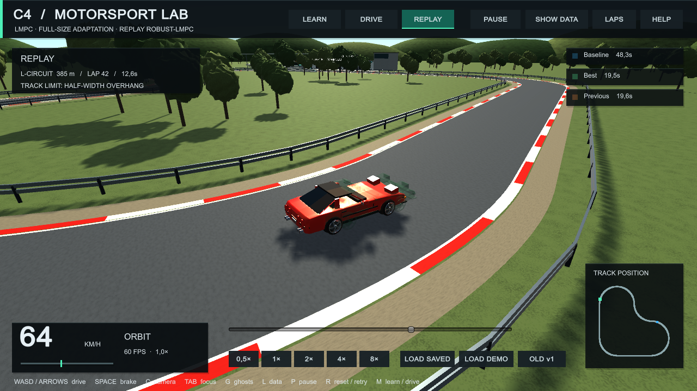
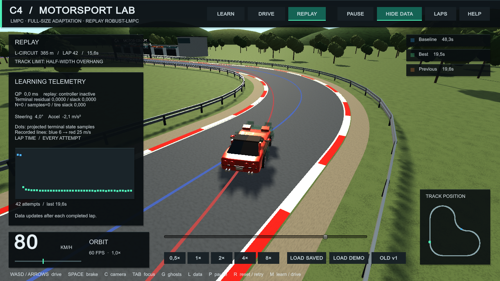
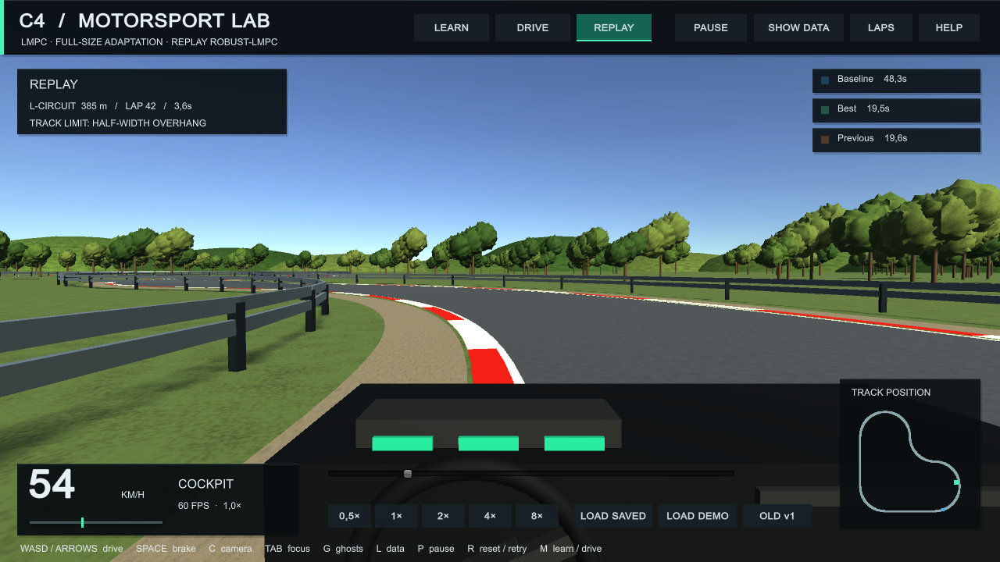

# Module 3.1 — Corvette C4 LMPC Racing Lab

A local racing simulator built in **Unity 6** with a Python learning model predictive controller, inspired by Rosolia and Borrelli's [Learning How to Autonomously Race a Car](https://doi.org/10.1109/TCST.2019.2948135) and their [RacingLMPC implementation](https://github.com/urosolia/RacingLMPC).

We built a C4-style car and a 385 m L-shaped circuit, with autonomous lap-time learning, baseline/previous/best ghost cars, keyboard driving, replay, five camera views, and optional racing-line and learning overlays. Manual driving is recorded separately from training.

## Download and run

1. [Download the Windows x64 portable ZIP](https://github.com/emilwallbom/module3.1/raw/refs/heads/main/deliverables/CorvetteLMPC-Portable-Windows-x64.zip).
2. Extract the **entire** folder into a writable location.
3. Double-click **Run Simulator.cmd**. Use **Watch Demo.cmd** for the recorded learning session.

Requires Windows 10/11 x64 and Direct3D 11 graphics. The Unity player, Python, and runtime dependencies are bundled; no separate installation or sign-in is needed. Do not run from inside the ZIP.

**Controls:** WASD/arrows drive · Space brakes · C camera · Tab focus · G ghosts · L overlays · P pause · R reset/retry · M learn/drive.

This is an **approximate full-size adaptation** with documented [differences from the paper](source/docs/PAPER_ALIGNMENT.md). Five seeds completed 40 valid learning laps each. The portable build passed relocation checks on the development PC; a separate clean PC has not been tested.

[Editable source and build instructions](source/README.md) · [Portable validation](source/docs/PORTABLE.md) · [Third-party notices](THIRD_PARTY_NOTICES.md)
